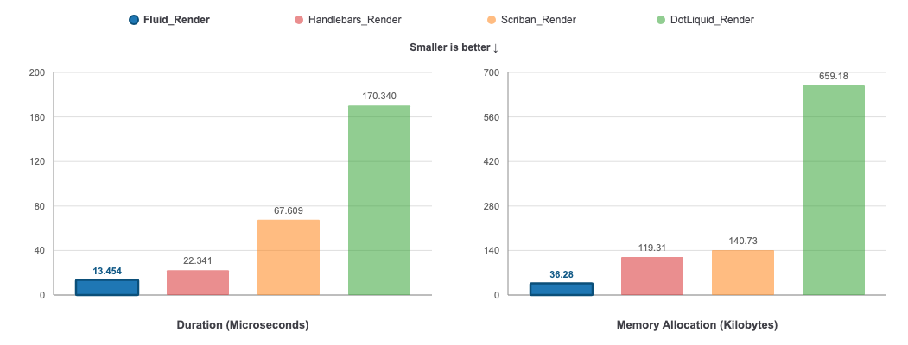

<p align="center">
  <picture>
    <source media="(prefers-color-scheme: dark)" srcset="https://github.com/sebastienros/fluid/raw/main/Assets/logo-vertical-dark.svg">
    
  </picture>
</p>

[](https://nuget.org/packages/Fluid.Core)
[](https://github.com/sebastienros/fluid/blob/main/LICENSE)
[](https://feedz.io/org/sebastienros/repository/fluid/packages/Fluid.Core)

## Basic Overview

Fluid is an open-source .NET template engine based on the [Liquid template language](https://shopify.github.io/liquid/). It is a **secure** template language that is also **very accessible** for non-programmer audiences.

> This document describes Fluid 3.0, which is under development on `main`. Preview packages are available from the [preview feed](#preview-packages); stable releases are available on [NuGet.org](https://www.nuget.org/packages/Fluid.Core).
> To see the corresponding content for v1.0, use [this version](https://github.com/sebastienros/fluid/blob/release/1.x/README.md)

Read the documentation at **[sebastienros.github.io/fluid](https://sebastienros.github.io/fluid/)**, and try Fluid in your browser with the **[playground](https://sebastienros.github.io/fluid/playground/)**.

<br>

## Features

- Very fast Liquid parser and renderer (no-regexp), with few allocations. See [benchmarks](#performance).
- Secure templates by allow-listing all available properties in the template. User templates can't break your application.
- Supports **async** filters. Templates can execute database queries more efficiently under load.
- Customize filters and tags with your own, even with complex grammar constructs. See [Customizing tags and blocks](#customizing-tags-and-blocks).
- Parses templates into a concrete syntax tree that lets you cache, analyze, and alter the templates before they are rendered.
- Register any .NET types and properties, or define **custom handlers** to intercept when a named variable is accessed.

<br>

## Tutorials

[Deane Barker](https://deanebarker.net) wrote a [very comprehensive tutorial](https://deanebarker.net/tech/fluid/) on how to write Liquid templates with Fluid.
For a high-level overview, read [The Four Levels of Fluid Development](https://deanebarker.net/tech/fluid/intro/), which describes different stages of using Fluid.

<br>

## Contents

- [Using Fluid in your project](#using-fluid-in-your-project)
- [Exposing .NET objects](#exposing-net-objects)
- [Source generators](#source-generators)
- [Adding custom filters](#adding-custom-filters)
- [Handling undefined values](#handling-undefined-values)
- [Rendering user-provided templates](#rendering-user-provided-templates)
- [Encoding](#encoding)
- [Cultures and time zones](#cultures-and-time-zones)
- [Additional filters](#additional-filters)
- [Liquid syntax](#liquid-syntax)
- [Customizing tags and blocks](#customizing-tags-and-blocks)
- [View engines](#view-engines)
- [Command line tool](#command-line-tool)
- [Performance](#performance)
- [Documentation](#documentation)
- [Contributing](#contributing)
- [Used by](#used-by)

<br>

#### Source

```Liquid
<ul id="products">
  
    <li>
      <h2>{{product.name}}</h2>
      Only {{product.price | price }}

      {{product.description | prettyprint | paragraph }}
    </li>
  
</ul>
```

#### Result

```html
<ul id="products">
    <li>
      <h2>Apple</h2>
      $329

      Flat-out fun.
    </li>
    <li>
      <h2>Orange</h2>
      $25

      Colorful. 
    </li>
    <li>
      <h2>Banana</h2>
      $99

      Peel it.
    </li>
</ul>
```

Notice
- The `<li>` tags are at the same index as in the template, even though the `{% for }` tag had some leading spaces
- The `<ul>` and `<li>` tags are on contiguous lines even though the `{% for }` is taking a full line.

<br>

## Using Fluid in your project

You can directly reference the [NuGet package](https://www.nuget.org/packages/Fluid.Core).

The code samples in this document assume you have registered the `Fluid` namespace with `using Fluid;`.

### Preview packages

After a successful build triggered by a push to `main`, preview packages (`3.0.0-preview.<run number>`) are published to the
[Fluid feed on feedz.io](https://f.feedz.io/sebastienros/fluid/nuget/index.json). Tagged releases continue to be published to NuGet.org.

```shell
dotnet nuget add source https://f.feedz.io/sebastienros/fluid/nuget/index.json --name fluid-preview
dotnet add package Fluid.Core --prerelease
```

Keep NuGet.org enabled so dependencies can be restored. If your `NuGet.config` uses package source
mapping, also map `Fluid.*` and `MinimalApis.LiquidViews` to the `fluid-preview` source.

### Hello World

#### Source

```csharp
var parser = new FluidParser();

var model = new { Firstname = "Bill", Lastname = "Gates" };
var source = "Hello {{ Firstname }} {{ Lastname }}";

if (parser.TryParse(source, out var template, out var error))
{   
    var context = new TemplateContext(model);

    Console.WriteLine(template.Render(context));
}
else
{
    Console.WriteLine($"Error: {error}");
}
```

#### Result
`Hello Bill Gates`

`TryParse` returns parsing diagnostics as a string. `Parse` throws a `ParseException` with the line and column of the error instead, see [Parsing errors](https://sebastienros.github.io/fluid/guide/rendering/#parsing-errors).

### Reusing instances

- A `FluidParser` is thread-safe and expensive to create: create it once and share it, for instance in a `static` field.
- An `IFluidTemplate` is thread-safe: cache parsed templates and render them concurrently.
- A `TemplateOptions` is immutable and thread-safe: build it once with a `TemplateOptionsBuilder` and reuse it. Call `ToBuilder()` to derive a variation, for instance one per tenant.
- A `TemplateContext` is __not__ thread-safe: create a new one for every rendering.

```csharp
private static readonly FluidParser _parser = new FluidParser();

private static readonly TemplateOptions _options = new TemplateOptionsBuilder()
    .WithCultureInfo(new CultureInfo("en-US"))
    .AddFilter("downcase", Downcase)
    .Build();

var context = new TemplateContext(model, _options);
```

Templates used by `include` and `render` are loaded from `TemplateOptions.FileProvider`, which can be asynchronous. See [Parsing and rendering](https://sebastienros.github.io/fluid/guide/rendering/) for file providers, scopes, cancellation and rendering to UTF-8.

<br>

## Exposing .NET objects

Templates can read the public properties and fields of the model and of the objects reachable through it. Treat the model as the template's readable data boundary: when rendering an untrusted template, pass a dedicated model that contains only the data the template is allowed to read.

Values are converted to Liquid values (`FluidValue`) when templates use them. To change how a type is exposed, add a value converter, which can return a different object or a custom `FluidValue`:

```csharp
var options = new TemplateOptionsBuilder()
    .AddValueConverter(value => value is IUser user ? user.Name : null)
    .Build();
```

`System.Text.Json.Nodes` values such as `JsonObject` and `JsonArray` can be used as models directly.

Member names are case-sensitive by default. Use `WithModelNamesComparer(StringComparers.CamelCase)` to read `FirstName` as `{{ firstName }}`, or another `StringComparer`.

Fluid works with NativeAOT and trimming: it falls back to reflection when dynamic code isn't supported, and the [model accessor generator](#model-accessors) avoids reflection altogether.

See [Models and values](https://sebastienros.github.io/fluid/guide/models-and-values/) for value converters, custom `FluidValue` types and arrays, explicit member registrations, custom member accessors and NativeAOT compatibility.

<br>

## Source generators

The `Fluid.SourceGenerator` package contains two independent source generators. You can use either one, or both:

- [Model accessors](#model-accessors) read the properties of your .NET types without reflection.
- [Compiled templates](#compiled-templates) turn `.liquid` files into C# code at build time.

Add the package to the project that renders the templates:

```xml
<ItemGroup>
  <PackageReference Include="Fluid.SourceGenerator" Version="..." />
</ItemGroup>
```

### Model accessors

Without this generator, Fluid uses reflection to read the members of your models. That works in most applications. Use the generator when the application is published with NativeAOT or trimming, where reflection can fail because the trimmer removed the members. It also avoids building accessors at runtime.

List the model types on a `partial` class that derives from `TemplateOptionsBuilder`, then build the options from it:

```csharp
[FluidRegister(typeof(Person))]
[FluidRegister(typeof(Address))]
public partial class AppTemplateOptionsBuilder : TemplateOptionsBuilder
{
}

var options = new AppTemplateOptionsBuilder().Build();
```

Templates can now read the public properties, public fields and parameterless methods of `Person` and `Address`, for example `{{ person.Address.City }}`. `new TemplateContext(person, options)` also detects a concrete `Person` model on its own.

See [Model accessor generator](https://sebastienros.github.io/fluid/guide/model-accessor-generator/) for profile methods, the exact rules and the diagnostics.

### Compiled templates

This generator compiles `.liquid` files into C# classes at build time, for templates that ship with the application, such as emails or reports. A syntax error fails the build instead of a request, nothing is parsed at startup, and the templates render faster than parsed ones. Templates only known at runtime, such as templates stored in a database or edited by users, are parsed with `FluidParser` as usual. Compiled templates can't use custom tags or operators, nor the `tablerow`, `ifchanged` and `doc` tags.

```xml
<ItemGroup>
  <AdditionalFiles Include="Templates/**/*.liquid" />
</ItemGroup>
```

```csharp
[FluidTemplates("Templates/*.liquid")]
public static partial class Templates
{
}

// Templates/welcome-email.liquid
var html = await Templates.WelcomeEmail.RenderAsync(context);
```

See [Compiled template generator](https://sebastienros.github.io/fluid/guide/template-generator/) for glob patterns, parser options, partials, naming rules and the diagnostics.

<br>

## Adding custom filters

Filters can be **async** or not. They are defined as a `delegate` that accepts an **input**, a **set of arguments** and the current **context** of the rendering process.

```csharp
public static ValueTask<FluidValue> Downcase(FluidValue input, FilterArguments arguments, TemplateContext context)
{
    return StringValue.Create(input.ToStringValue(context).ToLower());
}

var options = new TemplateOptionsBuilder()
    .AddFilter("downcase", Downcase)
    .Build();
```

<br>

## Handling undefined values

By default, undefined variables and filters render as empty strings, and unknown filters return their input. To fail fast instead, enable strict modes, which throw a `FluidException`:

```csharp
var options = new TemplateOptionsBuilder()
    .WithStrictVariables()
    .WithStrictFilters()
    .Build();
```

To track missing values or render a fallback, set a delegate that receives the path of each undefined variable:

```csharp
var options = new TemplateOptionsBuilder()
    .WithUndefined((path, type) =>
    {
        logger.LogWarning("Missing variable: {Path}", path);
        return ValueTask.FromResult<FluidValue>(NilValue.Instance);
    })
    .Build();
```

See [Handling undefined values](https://sebastienros.github.io/fluid/guide/rendering/#handling-undefined-values) for more examples.

<br>

## Rendering user-provided templates

Fluid is a template engine, not a security sandbox. When templates come from users:

1. Limit the template source length before parsing.
2. Pass a dedicated model containing only data the user is allowed to read.
3. Configure recursion, work, output and collection limits: `MaxSteps`, `MaxOutputSize` and `MaxCollectionSize` are unlimited by default.
4. Set a per-render cancellation deadline with `TemplateContext.CancellationToken`.
5. Keep the default null file provider, or use one scoped to the tenant, if templates don't need `include`, `render` or `from`.
6. Only expose trusted custom filters, tags and values.

```csharp
private static readonly TemplateOptions UserTemplateOptions = new TemplateOptionsBuilder()
    .WithMaxRecursion(20)
    .WithMaxSteps(10_000)
    .WithMaxOutputSize(1_000_000)
    .WithMaxCollectionSize(10_000)
    .Build();
```

See [Security](https://sebastienros.github.io/fluid/guide/security/) for what each limit counts and a complete example.

<br>

## Encoding

By default, Fluid doesn't encode the output. Pass an encoder when rendering, for instance `HtmlEncoder.Default`, or `HtmlEncoder.Create(UnicodeRanges.All)` to keep non-ASCII text readable:

```csharp
var html = await template.RenderAsync(context, HtmlEncoder.Default);
```

The `raw` filter and the `` tag prevent a value from being encoded, and the content of a `capture` block isn't encoded twice:

```Liquid


Encoded: {{ html }}
Not encoded: {{ html | raw }}
```

The `json` filter uses the `JsonSerializerOptions` set with `TemplateOptionsBuilder.WithJsonSerializerOptions()`. See [Encoding](https://sebastienros.github.io/fluid/guide/rendering/#encoding) for details.

<br>

## Cultures and time zones

Templates are rendered with the _invariant_ culture by default, so that results are consistent across systems. Set a culture with `TemplateOptionsBuilder.WithCultureInfo()` or `TemplateContext.CultureInfo`:

```csharp
var options = new TemplateOptionsBuilder()
    .WithCultureInfo(new CultureInfo("fr-FR"))
    .Build();
```

```Liquid
{{ 1234.56 }}
{{ "now" | date: "%A %-d %B %Y" }}
```

The time zone, set with `TemplateOptionsBuilder.WithTimeZone()` or `TemplateContext.TimeZone`, is used when **parsing** date strings without an offset. To display a date in another time zone, use the `time_zone` filter:

```Liquid
{{ published | time_zone: 'America/New_York' | date: '%+' }}
```

Like in Ruby, `%Z` is the abbreviation of the time zone, like `EST`, read from the system's time zone database on Linux and macOS (the offset on Windows), `UTC` for UTC times, and empty for a time with another offset than the time zone's. **Breaking change:** it used to be the offset.

A `TimeSpan` renders like `13:00:00`, and the date filters read it as a time of day in that time zone, so `{{ opening | date: '%H:%M %z' }}` renders `13:00 -0500` in New York.

Dates behave like Ruby's in Liquid. A moment renders like a `Time`, with its offset (`2026-03-04 13:00:00 -0500`, or `UTC` for a `DateTime` of `Utc` kind), and a `DateTime` of `Unspecified` kind is read in that time zone, never in the machine's one. A `DateOnly` is like a `Date`: it renders `2026-03-04` and is read at midnight UTC. A `TimeOnly` renders `13:00:00` and is read on the current date. Dates are ordered in `<`, `>` and `sort`, and so are two `TimeOnly` or two `TimeSpan` values, and are `0` in math filters: do date math on their Unix time, like `{{ starts | date: '%s' | plus: 86400 | date: '%F' }}`. Only integers are timestamps, so `{{ 0.5 | date: '%L' }}` returns `0.5`. **Breaking change:** dates used to render in UTC (`2026-03-04 18:00:00Z`), `Unspecified` ones got the machine's offset, a `DateOnly` became a string like `03/04/2026` (read as April 3), comparing dates was always false, a date was its number of ticks in math filters, and numbers with a fraction were timestamps.

See [Cultures, dates and time zones](https://sebastienros.github.io/fluid/guide/localization/) and [Working with time zones](https://sebastienros.github.io/fluid/guide/time-zones/).

<br>

## Additional filters

Fluid provides some non-standard filters by default, which format values with .NET format strings and an optional culture name:

| Source | Result |
| --- | --- |
| `{{ "now" \| format_date: "G" }}` | `6/15/2009 1:45:30 PM` |
| `{{ 123 \| format_number: "N" }}` | `123.00` |
| `{{ "hello {0} {1:C}" \| format_string: "world", 123 }}` | `hello world $123.00` |

The [Shopify money filters](https://shopify.dev/docs/api/liquid/filters/money) and the color filters are opt-in:

```csharp
var options = new TemplateOptionsBuilder()
    .WithMoneyFilters()
    .WithColorFilters()
    .Build();
```

| Source | Result |
| --- | --- |
| `{{ 1134.65 \| money }}` | `$1,134.65` |
| `{{ 1134.65 \| money_with_currency }}` | `$1,134.65 USD` |
| `{{ 'rgb(10%, 10%, 20%)' \| color_to_hex }}` | `#1a1a33` |

See [Optional and Fluid-specific filters](https://sebastienros.github.io/fluid/guide/filters/) for currencies, amounts in cents, custom money formats and supported colors.

<br>

## Liquid syntax

Fluid follows the syntax and the behavior of [Shopify Liquid](https://shopify.github.io/liquid/).

### Whitespace control

By default, all spaces and new lines of a template are preserved. Hyphens strip the whitespace on their side of a tag or an output:

```liquid

{{ name }}
```

renders `Bill` without the new line that follows the `assign` tag. `TemplateOptionsBuilder.WithTrimming()` strips whitespace automatically, even without hyphens.

### Partials

`render` renders a partial in an isolated context, and `include` in the context of the template. Partials are loaded from `TemplateOptions.FileProvider`:

```liquid


```

### Extensions

Some extensions that are not part of Liquid can be enabled on the parser:

```csharp
var parser = new FluidParser(new FluidParserOptions
{
    AllowFunctions = true,             // ,  and {{ field('user') }}
    AllowParentheses = true,           // {{ 1 | plus: (2 | times: 3) }}
    AllowStringEscapeSequences = true, // {{ "line\nbreak" }}
    AllowLiquidTag = true,             // 
});
```

With functions enabled, `macro` declares reusable chunks of content that are invoked like functions, and `from` imports the macros of another template:

```liquid

<input type="{{ type }}" name="{{ name }}" value="{{ value }}" />


{{ field('user') }}
{{ field('pass', type='password') }}
```

See [Liquid syntax](https://sebastienros.github.io/fluid/guide/syntax/) for how Fluid reads tags like Shopify, `include` and `render`, whitespace, the `self` object, macros and the other extensions.

<br>

## Customizing tags and blocks

Fluid's grammar can be extended with custom tags, blocks and operators. The parser is based on [Parlot](https://github.com/sebastienros/parlot), which makes it completely extensible.

```csharp
parser.RegisterIdentifierTag("hello", (identifier, writer, encoder, context) =>
{
    writer.Write("Hello ");
    writer.Write(identifier);
});
```

```Liquid

```

Blocks also receive the statements they contain:

```csharp
parser.RegisterExpressionBlock("repeat", async (value, statements, writer, encoder, context) =>
{
    var count = (await value.EvaluateAsync(context)).ToNumberValue(context);

    for (var i = 0; i < count; i++)
    {
        await statements.RenderStatementsAsync(writer, encoder, context);
    }

    return Completion.Normal;
});
```

```Liquid
Hi! 
```

renders `Hi! Hi! Hi! `. Custom operators are registered with `parser.RegisteredOperators`.

Templates can also be analyzed and rewritten with the `AstVisitor` and `AstRewriter` classes. See [Extending the grammar](https://sebastienros.github.io/fluid/guide/extensibility/) for blocks, custom parsers, operators, functions and visitors.

<br>

## View engines

The `Fluid.MvcViewEngine` package lets ASP.NET Core MVC render Liquid views, alone or with Razor, with layouts, sections and `_ViewStart.liquid` files:

```csharp
services.AddMvc().AddFluid();
```

A view selects a layout and fills its sections, and the layout renders them:

```Liquid


This is the home page


  This text will go in the footer

```

```Liquid
<html>
  <body>
    
    <div class="footer"></div>
  </body>
</html>
```

A view, a layout or a partial that can't be found throws a `FileNotFoundException`, unless `FluidViewEngineOptions.TemplateNotFound` renders something else (see [Missing views, layouts and partials](https://sebastienros.github.io/fluid/guide/view-engine/#missing-views-layouts-and-partials)).

`Fluid.ViewEngine` provides the same features without MVC, and `MinimalApis.LiquidViews` renders Liquid views from Minimal APIs. See [View engines](https://sebastienros.github.io/fluid/guide/view-engine/).

<br>

## Command line tool

The `Fluid.Core.Tool` .NET tool installs a `liquid` command that renders Liquid templates from any shell, with JSON read from stdin (or `--data <file>`) as the model.

```shell
dotnet tool install -g Fluid.Core.Tool
echo '{"name":"World"}' | liquid -e "Hello {{ name | upcase }}!"
liquid page.liquid --data model.json --output page.html
liquid -e "{{ user }} on {{ env.HOME }}" --set user=Bob --env
liquid page.liquid --validate
```

Run `liquid --help`, or see the [tool's README](https://github.com/sebastienros/fluid/blob/main/Fluid.Core.Tool/README.md), for all options, such as include paths, culture, time zone, strict mode and execution limits.

<br>

## Performance

Fluid is faster and allocates less memory than all other well-known .NET Liquid parsers. To get the best performance, cache `IFluidTemplate` instances, and reuse the `FluidParser` and `TemplateOptions` instances (see [Reusing instances](#reusing-instances)).



See [Benchmarks](https://sebastienros.github.io/fluid/benchmarks/) for parsing results, compiled templates and the Benchmark.NET data.

<br>

## Documentation

The [documentation site](https://sebastienros.github.io/fluid/) covers the details, and the [playground](https://sebastienros.github.io/fluid/playground/) renders templates with Fluid in your browser.

- [Getting started](https://sebastienros.github.io/fluid/guide/getting-started/)
- [Parsing and rendering](https://sebastienros.github.io/fluid/guide/rendering/)
- [Models and values](https://sebastienros.github.io/fluid/guide/models-and-values/)
- [Model accessor generator](https://sebastienros.github.io/fluid/guide/model-accessor-generator/)
- [Compiled template generator](https://sebastienros.github.io/fluid/guide/template-generator/)
- [Security](https://sebastienros.github.io/fluid/guide/security/)
- [Liquid syntax](https://sebastienros.github.io/fluid/guide/syntax/)
- [Optional and Fluid-specific filters](https://sebastienros.github.io/fluid/guide/filters/)
- [Cultures, dates and time zones](https://sebastienros.github.io/fluid/guide/localization/)
- [Working with time zones](https://sebastienros.github.io/fluid/guide/time-zones/)
- [Extending the grammar](https://sebastienros.github.io/fluid/guide/extensibility/)
- [View engines](https://sebastienros.github.io/fluid/guide/view-engine/)
- [Benchmarks](https://sebastienros.github.io/fluid/benchmarks/)

When questioning the result of a template, compare it with the Liquid gem, as described in [Contributing](#contributing).

<br>

## Contributing

Build with `dotnet build` and test with `dotnet test`: see [AGENTS.md](https://github.com/sebastienros/fluid/blob/main/AGENTS.md) for the build rules, the [Golden Liquid](https://github.com/jg-rp/golden-liquid) tests and the architecture.

Fluid follows the [Liquid gem](https://github.com/Shopify/liquid), the reference implementation. To check what the gem renders, and compare it with Fluid, run a template in Docker with `scripts/liquid-gem/liquid-gem.cs`:

```shell
dotnet run scripts/liquid-gem/liquid-gem.cs -- -e '{{ "a,b" | split: "," | join: "-" }}'
dotnet run scripts/liquid-gem/liquid-gem.cs -- -c -e ' {{ i }} '
dotnet run scripts/liquid-gem/liquid-gem.cs -- -c template.liquid -d data.json -z America/New_York
```

`-c` renders the template with Fluid too and shows the difference, `-d` (a file) or `-j` (inline JSON) gives its variables, and `--help` lists the options, like the notation for dates. It needs Docker.

<br>

## Used by

Fluid is known to be used in the following projects:
- [Orchard Core CMS](https://github.com/OrchardCMS/OrchardCore) Open Source .NET modular framework and CMS
- [MaltReport](https://github.com/oldrev/maltreport) OpenDocument/OfficeOpenXML powered reporting engine for .NET and Mono
- [Elsa Workflows](https://github.com/elsa-workflows/elsa-core) .NET Workflows Library
- [FluentEmail](https://github.com/lukencode/FluentEmail) All in one email sender for .NET
- [NJsonSchema](https://github.com/RicoSuter/NJsonSchema) Library to read, generate and validate JSON Schema draft v4+ schemas
- [NSwag](https://github.com/RicoSuter/NSwag) Swagger/OpenAPI 2.0 and 3.0 toolchain for .NET
- [Optimizely](https://world.optimizely.com/blogs/deane-barker/dates/2023/1/introducing-liquid-templating/) An enterprise .NET CMS
- [Rock](https://github.com/SparkDevNetwork/Rock) Relationship Management System
- [TemplateTo](https://templateto.com) Powerful Template Based Document Generation
- [Weavo Liquid Loom](https://www.weavo.dev) A Liquid Template generator/editor + corresponding Azure Logic Apps Connector / Microsoft Power Automate Connector
- [Semantic Kernel](https://github.com/microsoft/semantic-kernel) Integrate cutting-edge LLM technology quickly and easily into your apps
- [Mailgen](https://github.com/hsndmr/Mailgen) A .NET package that generates clean, responsive HTML e-mails for sending transactional mail
- [LiquidPages](https://www.kinetq.com/docs/open-source-software/liquid-pages) Middleware that can be used with any web server to render liquid templates.

_Please create a pull request to be listed here._
